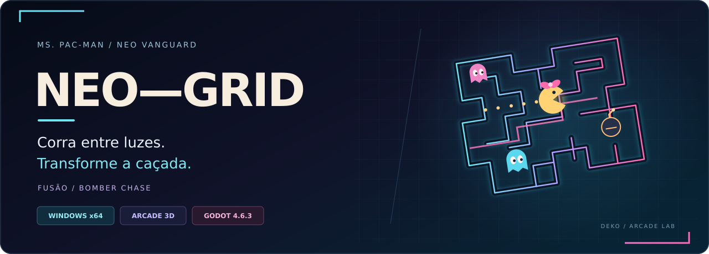
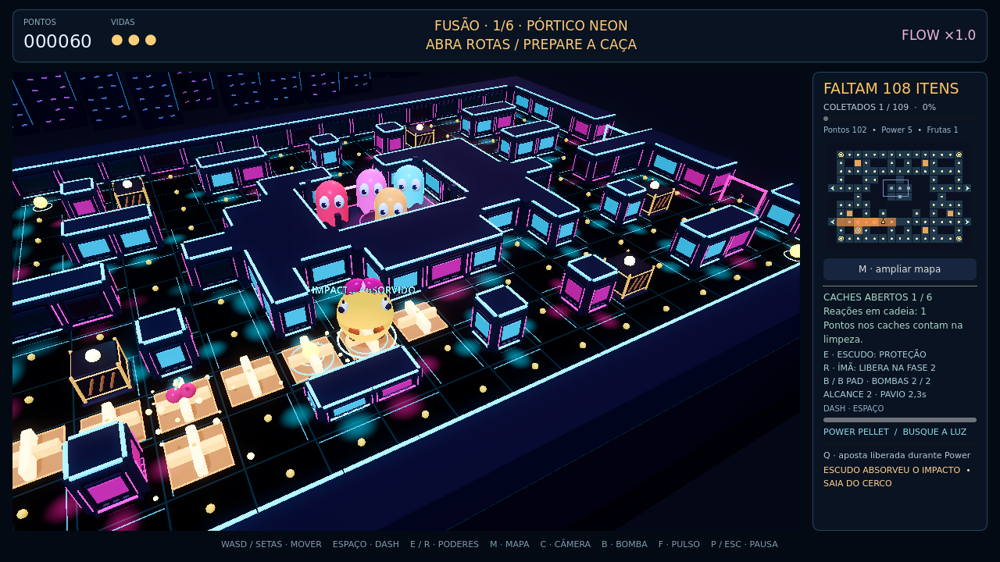
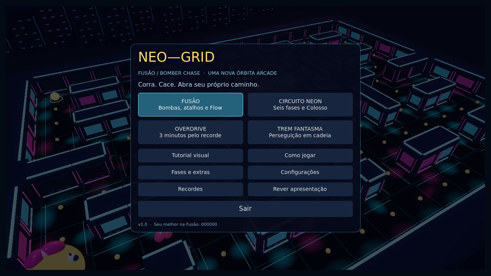
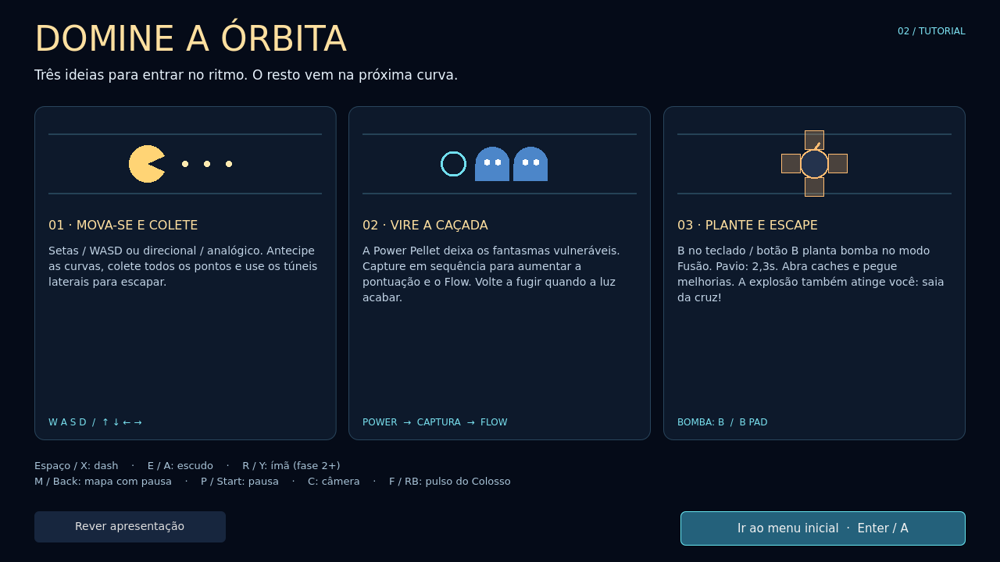
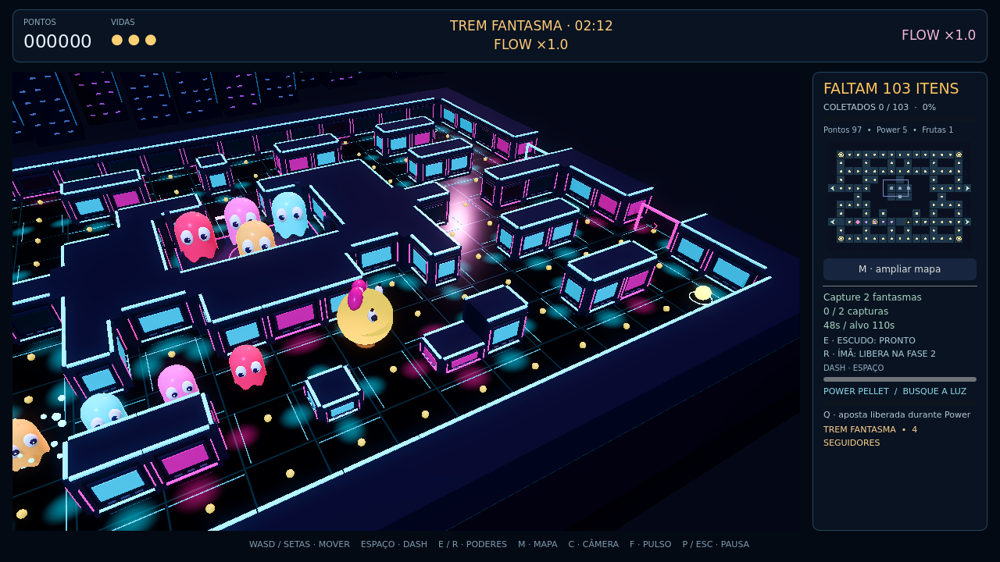
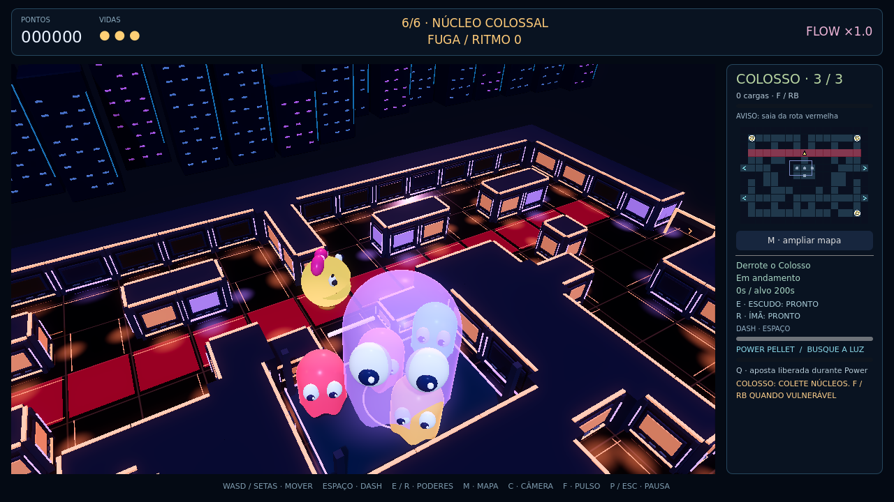

<p align="center">
  
</p>

<p align="center">
  <strong>6 fases · 4 modos · Power + Flow · Túneis de escape · Bombas e atalhos</strong>
</p>

<p align="center">
  <a href="#jogar-e-baixar">🎮 Jogar e baixar</a> ·
  <a href="#dentro-da-arena">Galeria</a> ·
  <a href="#escolha-seu-ritmo">Modos</a> ·
  <a href="#controles">Controles</a> ·
  <a href="#codigo-e-evolucao">Código e evolução</a>
</p>

Um arcade 3D neon em que cada curva pode virar a partida. Colete pontos, atravesse túneis, escape do cerco e transforme a perseguição em uma sequência de capturas. No **Fusão / Bomber Chase**, plante bombas, abra caches e crie suas próprias rotas pelo labirinto.

**A identidade:** arquitetura metálica, luzes ciano e magenta, piso polido e câmera em perspectiva. A essência clássica está nas rotas do labirinto, nos túneis e na casa de regeneração dos fantasmas.

<a id="dentro-da-arena"></a>
## Dentro da arena

<p align="center">
  
  <br><sub><strong>Fusão / Bomber Chase</strong> · Planeje a explosão. Abra a passagem. Saia da cruz.</sub>
</p>

<table>
  <tr>
    <td width="50%"><br><strong>Sua próxima partida</strong><br><sub>Menu 1.0 · Quatro maneiras de entrar no ritmo.</sub></td>
    <td width="50%"><br><strong>Entre no jogo</strong><br><sub>Tutorial 1.0 · Movimento, caçada e bombas.</sub></td>
  </tr>
  <tr>
    <td width="50%"><br><strong>Trem Fantasma</strong><br><sub>Acumule perseguição. Busque Power. Inverta a caçada.</sub></td>
    <td width="50%"><br><strong>O encontro final</strong><br><sub>Leia os avisos do Colosso e escolha a hora de atacar.</sub></td>
  </tr>
</table>

As imagens acima são **capturas do próprio motor**, em cenas de QA com estado controlado, nas versões indicadas. Foram renderizadas em Linux/Forward+/Vulkan com llvmpipe; não representam uma medição de desempenho em GPU física. A capa é uma composição vetorial da identidade do projeto.

<a id="escolha-seu-ritmo"></a>
## Escolha seu ritmo

| Modo | A experiência |
| :--- | :--- |
| **Fusão / Bomber Chase** | Seis fases com bombas, explosões em cruz e reações em cadeia. Caches abrem atalhos, revelam pontos e melhoram seu arsenal. |
| **Circuito Neon** | Seis labirintos, desafios opcionais, melhorias entre áreas e o confronto com o Colosso. |
| **Overdrive** | Três minutos para buscar o recorde, com pulsos de caça e revanche imediata. |
| **Trem Fantasma** | Três minutos com seguidores em cadeia. A Power Pellet transforma o perigo acumulado em oportunidade. |

**O que dá ritmo à partida**

- **Power + Flow:** capturas em sequência aumentam pontuação e impacto sonoro.
- **Frutas móveis:** uma oportunidade temporária para quem aceita desviar da rota.
- **Bombas táticas:** sem Power, atordoam fantasmas; com Power, capturam. A própria explosão também atinge você.
- **Mapa que informa:** contador de itens obrigatórios, últimos pontos destacados e caches identificados.
- **Controle do seu jeito:** teclado ou controle, vista em perspectiva ou superior e redução de movimento.

Na **1.0**, a entrada no jogo segue **minivídeo de 9 segundos → tutorial ilustrado → menu inicial**. É possível pular e rever a apresentação. Ms. Pac-Man aguarda o primeiro comando direcional; no Fusão, plantar uma bomba também inicia o tempo.

<a id="jogar-e-baixar"></a>
## Jogar e baixar

| Quero… | Versão e conteúdo | Acesso |
| :--- | :--- | :--- |
| **Jogar a entrega mais recente** | **1.0 · Apresentação Final**, Windows x64, com abertura, tutorial e os quatro modos. | [Baixar o pacote 1.0 pela entrega ChatGPT](https://chatgpt.com/api/library/files/libfile_0e2f8bb1b3108191b69c370ded94c71f/download) |
| **Explorar os fontes publicados** | **0.9 · Fusão / Bomber Chase**, Godot, regras, cenas e testes. | [Abrir os fontes 0.9](https://github.com/DekoMao/Ms.-Pac-Man-Neo-Vanguard/tree/feature/fusao-bomber-20261019) · [Revisão #6](https://github.com/DekoMao/Ms.-Pac-Man-Neo-Vanguard/pull/6) |
| **Baixar um binário já hospedado no GitHub** | **0.2 · Ação**, entrega anterior, sem os recursos posteriores. | [Windows 0.2](https://github.com/DekoMao/Ms.-Pac-Man-Neo-Vanguard/blob/22dfd319e19eefe73d9e2110f7c9c613b191d86a/NeoGrid_Acao_0_2_Windows_x64.zip?raw=true) |
| **Assistir ao registro anterior** | **0.2 · Vídeo contínuo de 45 segundos**, com áudio. | [Abrir o vídeo 0.2](https://github.com/DekoMao/Ms.-Pac-Man-Neo-Vanguard/blob/22dfd319e19eefe73d9e2110f7c9c613b191d86a/NeoGrid_Acao_45s.mp4) |

> **Sobre o acesso à 1.0:** o link usa o arquivo entregue pelo ChatGPT e exige a conta que recebeu essa entrega. O ZIP e os fontes da 1.0 ainda não foram publicados no GitHub. A distribuição 0.2 é histórica e não corresponde às imagens das versões 0.8–1.0.

**Para jogar:** baixe o ZIP desejado, extraia a pasta inteira e abra `MsPacMan_Aperfeicoado.exe`. O jogador não precisa instalar Godot ou Python. Na 1.0, avance pelo tutorial e escolha um modo. `TESTAR_WINDOWS.cmd` permite registrar diagnóstico local da sessão, sem envio de dados.

<a id="controles"></a>
## Controles

| Ação | Teclado | Controle |
| :--- | :--- | :--- |
| Mover / antecipar curvas | WASD ou setas | Direcional / analógico |
| Dash | Espaço | X |
| Plantar bomba no Fusão | B | B |
| Escudo | E | A |
| Ímã, a partir da fase 2 | R | Y |
| Aposta durante Power | Q | LB |
| Pulso do Colosso | F | RB |
| Mapa com pausa | M | Back |
| Pausa | P / Esc | Start |
| Trocar perspectiva / vista superior | C | — |
| Tela cheia | F11 | — |

As letras do controle seguem o padrão Xbox. O escudo absorve um impacto; dash não torna a personagem invulnerável. O pulso exige carga e uma janela de vulnerabilidade do Colosso.

<a id="codigo-e-evolucao"></a>
## Código e evolução

| Marco | Foco | Situação |
| :--- | :--- | :--- |
| **0.2 · Ação** | Pressão, captura, câmera e áudio. | [Binários, vídeo e fontes arquivados](https://github.com/DekoMao/Ms.-Pac-Man-Neo-Vanguard/tree/entrega/acao-20261019). |
| **0.8 · Circuito Vivo** | Seis fases, frutas móveis, Overdrive, Trem Fantasma e Colosso. | [Fontes publicados](https://github.com/DekoMao/Ms.-Pac-Man-Neo-Vanguard/tree/feature/circuito-vivo-20261019). |
| **0.9 · Fusão** | Bombas, caches, atalhos e progressão do arsenal. | [Fontes publicados; revisão em rascunho](https://github.com/DekoMao/Ms.-Pac-Man-Neo-Vanguard/pull/6). |
| **1.0 · Apresentação Final** | Minivídeo, tutorial e menu inicial. | Pacote entregue separadamente; sincronização dos fontes no GitHub pendente. |

**Para trabalhar no código publicado**, use a branch dos fontes, pois esta página principal organiza a apresentação e as entregas:

```bash
git clone --branch feature/fusao-bomber-20261019 https://github.com/DekoMao/Ms.-Pac-Man-Neo-Vanguard.git
cd Ms.-Pac-Man-Neo-Vanguard
python scripts/build.py --godot godot
```

A reconstrução da **0.9** exige Godot **4.6.3 stable**, os templates oficiais correspondentes e Python. [Regras da Fusão e benchmark](https://github.com/DekoMao/Ms.-Pac-Man-Neo-Vanguard/blob/feature/fusao-bomber-20261019/docs/FUSAO_BOMBER_CHASE.md) · [Validação no Windows](https://github.com/DekoMao/Ms.-Pac-Man-Neo-Vanguard/blob/feature/fusao-bomber-20261019/docs/VALIDACAO_WINDOWS.md) · [Mapa das entregas e integridade](docs/showcase/ESTADO_DAS_VERSOES.md).

**Validação da entrega 1.0:** 485 verificações aprovadas no Godot/Linux e abertura do conteúdo embutido do executável, incluindo vídeo → tutorial → menu. Execução nativa Windows, controle físico e desempenho em GPU física permanecem pendentes. Esses testes não medem diversão ou equilíbrio com jogadores.

<details>
<summary>Procedência e entregas preservadas</summary>

Código, malhas, interface e áudio do NeoGrid foram produzidos para o projeto. A referência Super-Bomberman-6-Unity orientou a análise de mecânicas; não foram copiados código C#, cenas ou assets Unity. Créditos dos componentes estão nas fontes e nos pacotes.

O pacote MV original na raiz e seu `SHA256SUMS.txt` continuam preservados. [Registro original do MV](docs/showcase/ENTREGA_MV_ORIGINAL.md). Links que contêm um SHA de commit mostram um retrato histórico; abra [a página principal do repositório](https://github.com/DekoMao/Ms.-Pac-Man-Neo-Vanguard) para ver esta apresentação atualizada.

</details>

---

<p align="center"><strong>NEO—GRID</strong><br><sub>Uma nova órbita arcade · Projeto de DekoMao</sub></p>
