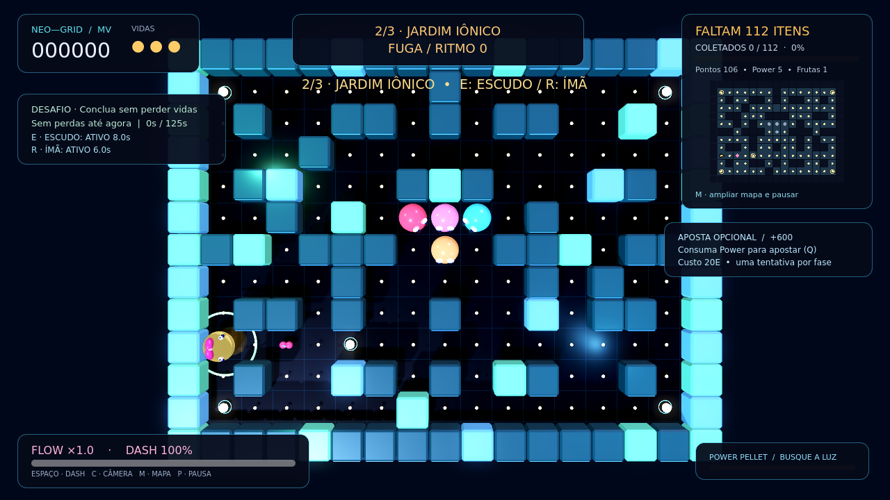
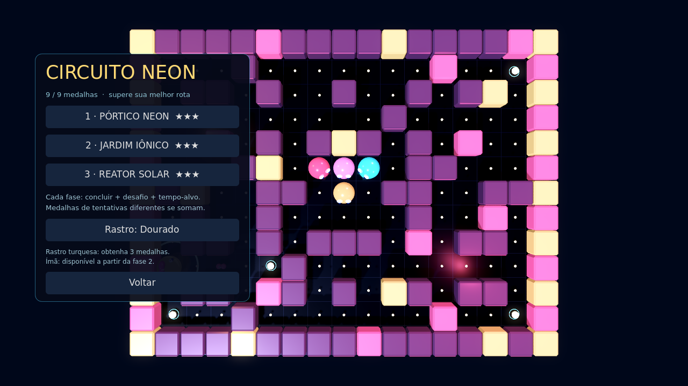

# Circuito Neon — MV 0.3.0

Três mapas, poderes limitados, desafios e recompensas persistentes acrescentam
metas à base aprovada. Não inclui multiplayer, loja ou geração procedural.

| Fase | Paleta | Itens | Desafio opcional | Alvo | Velocidade hostil base |
| --- | --- | ---: | --- | ---: | ---: |
| Pórtico Neon | Ciano/magenta | 109 | Capture 2 fantasmas | 110s | 100% |
| Jardim Iônico | Verde/azul | 112 | Sem perder vidas | 125s | 106% |
| Reator Solar | Âmbar/rosa | 105 | Vença uma aposta Q | 140s | 112% |

Mapas 17×13 distintos e conectados antes/depois da troca de parede segura.
Velocidade do jogador preservada; os multiplicadores hostis combinam com a
pressão existente. Limpar permite avançar por botão, carregando os pontos e
recuperando uma vida até três. A fase 3 encerra o circuito. Reiniciar circuito
volta à fase 1; o seletor inicia nova tentativa com zero pontos/três vidas.

## Poderes e recompensas

- E: uma carga de escudo por fase, até 8s. Absorve um contato hostil e dá 1s
  para escapar; não muda a captura de vulneráveis. Não pertence ao dash.
- R: uma carga de ímã nas fases 2/3, 6s, apenas pontos normais vizinhos.
  Não atrai frutas/Power, não atravessa paredes nem alcança células diagonais.
- Pausa/mapa congelam durações. Morte encerra efeitos sem repor cargas;
  cargas não gastas permanecem. A fase seguinte renova cargas.
- Medalhas por limpeza, desafio e tempo; bônus 500 + 250 + 250, uma vez na
  conclusão. Desafios são opcionais, sem bloquear o avanço.
- Medalhas persistem por união entre tentativas, sem duplicação. Três liberam
  rastro turquesa no menu de fases/extras; ele respeita redução de efeitos.

Save schema 3 conserva configurações e recorde MV, registra novo recorde
separado, fases, medalhas e rastro. Não salva partida em andamento. Perfis dos
testes não são distribuídos; perfil novo começa na fase 1, sem medalhas.

## Evidências e limites

Godot 4.6.3.stable.official.7d41c59c4, Linux:

| Suíte | Aprovadas |
| --- | ---: |
| Regras/colisões | 39 |
| Ação/Flow | 27 |
| Progresso/mapas | 16 |
| Campanha/poderes/recompensas/save | 36 |
| Cena/entradas/áudio/transições | 45 |
| **Total** | **163** |

Os três mapas foram limpos por movimentação automatizada com inimigos
desativados, para conferir coleta/rotas. A cena testa avanço até o final,
seletor, pausa, cargas e preservação de progresso. Dificuldade e tempos-alvo
precisam de avaliação humana com inimigos ativos.

O builder exige as cinco suítes, exporta Windows x64 0.3.0.0, aplica ícone/versão
e testa o PCK no motor Linux fora das fontes. **PE nativo Windows e GPU física
permanecem pendentes.** Relatórios: `evidencias/testes_*.json` e logs do builder.
Base: `70f1da18bde7b0734ef6f9bfffc18a80641f0a1d`.

Capturas reais em Linux/Xvfb, Compatibility/llvmpipe, sem SSR. Preparações
automatizadas para interface (inclusive nove medalhas/tela final), não partidas
humanas ou evidência de Forward+. Com servidor gráfico disponível:

```bash
godot --path . --rendering-method gl_compatibility --script res://tests/capture_campaign.gd
```




