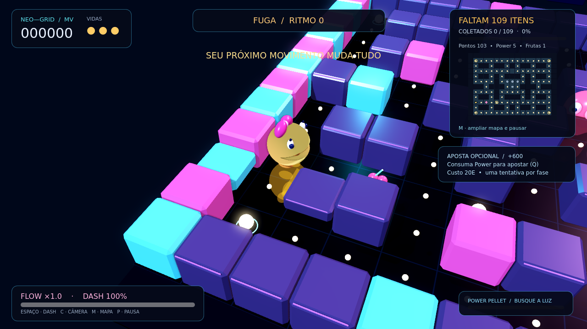
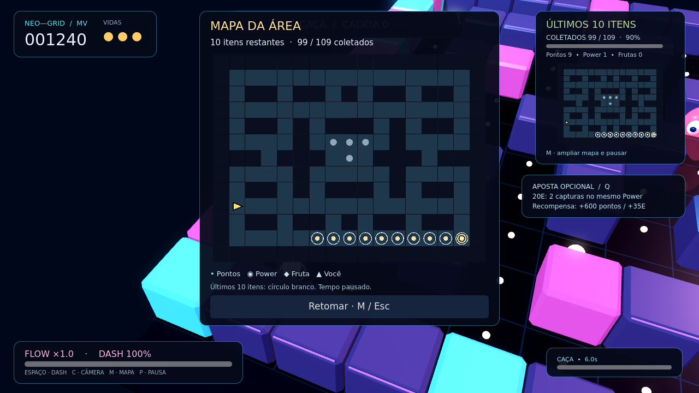

# MV 0.2.1 — progresso e orientação no mapa

O jogador agora consegue saber quanto falta e localizar os itens que restam.
Esta revisão atende ao feedback sobre o mapa da 0.2.0; mantém música, regras,
ritmo, modelos 3D e efeitos daquela versão.

## O que aparece durante a partida

- Contador permanente **FALTAM N ITENS**, acompanhado de **COLETADOS X / TOTAL**,
  percentual e barra de progresso.
- Contagem separada dos pontos normais, Power Pellets e frutas restantes.
- Minimapa maior com todos os itens ainda presentes; itens coletados desaparecem.
- Os últimos dez itens recebem círculos brancos fixos em ambos os mapas.
- **M** abre um mapa ampliado com legenda, pausando tempo e todas as camadas
  musicais. **M**, **Esc**, **P** ou o botão Retomar continuam a partida.

Na área atual, o início tem **109 itens: 103 pontos, 5 Power Pellets e 1 fruta**.
A fruta faz parte da condição de vitória existente. Pontuação de combos,
capturas e Flow não entra no contador de coleta.

O progresso é lido da simulação: morte preserva a coleta, reinício restaura o
total, contato repetido não decrementa duas vezes e dash coleta os itens
atravessados. O mapa usa o grafo atual das rotas, inclusive após a troca de parede.
Só aparece 100% quando a área está limpa.

## Validação desta revisão

Godot **4.6.3.stable.official.7d41c59c4**, host Linux, execução headless:

| Suíte | Aprovadas | Falhas |
| --- | ---: | ---: |
| Regras e colisões | 39 | 0 |
| Ação e Flow | 27 | 0 |
| Integração da cena, áudio e entradas | 31 | 0 |
| Contagem de coleta e escala dos mapas | 16 | 0 |
| **Total** | **113** | **0** |

Além das suítes, passaram importação, smoke do projeto, exportação Windows x64,
aplicação de ícone/versão e smoke do PCK embutido carregado no motor Linux fora
da pasta-fonte. Relatórios em `evidencias/testes_*.json`, `build_artefato.json`
e logs do builder. `scripts/build.py` agora exige também a suíte do mapa.

O executável é Windows x64, com PCK embutido, versão 0.2.1.0 e sem assinatura.
**Não foi executado nativamente no Windows.** A inspeção/renderização Linux
não homologa desempenho em GPU física nem garante o comportamento do driver Windows.

## Imagens reais da interface

Capturas do motor Godot, em Linux/Xvfb, OpenGL Compatibility/llvmpipe. O host
não dispõe da extensão Vulkan de superfície necessária e usou fallback gráfico;
estas imagens conferem legibilidade e disposição do mapa, não o acabamento
Forward+ nem desempenho. A segunda imagem usa uma preparação automatizada de
coleta para deixar exatamente dez itens; não representa uma partida humana.





## Reconstrução e teste no PC

Com Godot 4.6.3, templates oficiais 4.6.3.stable e Python:

```powershell
python scripts/build.py --godot 'C:\caminho\Godot.exe'
```

O resultado fica em `entrega/MsPacMan_Aperfeicoado/MsPacMan_Aperfeicoado.exe`.
Extraia o pacote portátil inteiro e abra o EXE. Durante o teste, confirme a
leitura do contador em 720p/1080p, coleta de cada tipo, mapa com M, retomada,
últimos dez itens, conclusão, morte e reinício. Essas verificações manuais
nativas permanecem pendentes.

A branch de correção é baseada em `refino/acao-20261019`, commit
`96618c46cb593c99c9ad617cda9febdefe6fbb16`. A entrega e a base anteriores
permanecem disponíveis; esta revisão não inclui novos modos nem acabamento
gráfico adicional.
