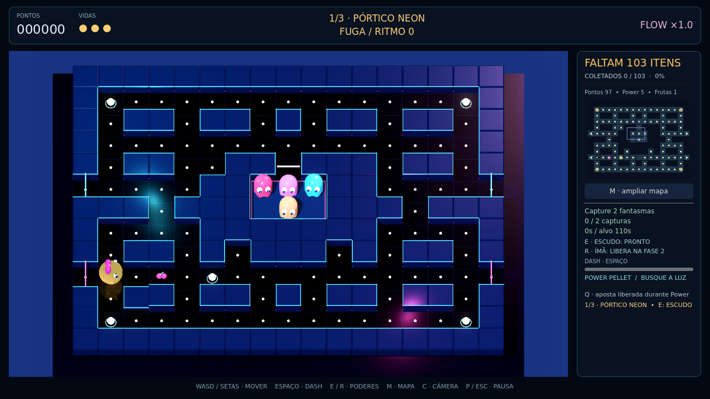
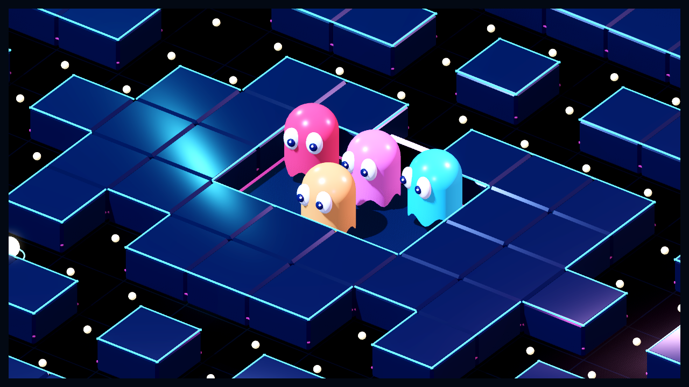

# MV 0.4.0 — clareza e essência arcade

O feedback da 0.3 apontou painéis sobre os corredores, menus desalinhados,
ausência de túneis/casa e fantasmas pouco expressivos. Esta revisão aborda
esses quatro problemas mantendo música, campanha, poderes e progresso salvo.

## Interface e câmera

A cena 3D é exibida em um SubViewport próprio, separado geometricamente do
cabeçalho, da coluna lateral e do rodapé. Durante a partida, nenhum painel cobre
os corredores. Coleta, minimapa, desafios, poderes e mensagens ficam na lateral.
A câmera ortográfica mostra o mapa inteiro e C alterna entre oblíqua/superior.
Menus são centralizados, têm limite de tamanho, texto ajustável e rolagem.
O mapa ampliado cobre a cena apenas enquanto a simulação está pausada.

As paredes agora são escuras, com contornos neon nas faces expostas; os grandes
blocos luminosos foram substituídos para melhorar a leitura dos personagens.

## Túneis e casa

Cada mapa tem dois pares de saídas esquerda/direita nas linhas 5 e 9, sinalizadas
por arcos e setas. A passagem custa uma célula de percurso e conserva direção.
Jogador e fantasmas usam a ligação; a IA considera esse caminho no cálculo de
distância. O teleporte é uma descontinuidade, sem linha de colisão pelo centro,
sem interpolação visual de ponta a ponta e sem rastro atravessando a tela.
A chegada continua sujeita a colisão hostil; dash não concede proteção.

A casa central tem piso próprio, perímetro e uma porta. O jogador e fantasmas
ativos não entram. Fantasmas saem pelo estado de saída; capturados retornam
como olhos, regeneram por 1,5s na casa e saem novamente. A imunidade da mesma
janela Power é preservada. Não há pontos obrigatórios dentro da casa.

Os corpos são opacos, com silhueta alongada, barra ondulada e olhos com pupilas
direcionais. Vulneráveis ficam azuis e mostram boca serrilhada; o retorno deixa
somente olhos. A redução de movimento mantém os sinais essenciais legíveis.

## Regressão e evidências

Godot 4.6.3, Linux: seis suítes, **196 verificações aprovadas**:
39 regras, 27 ação, 16 mapa, 36 campanha, 45 integração e 33 arcade.
Inclui conclusão dos três mapas por movimento com inimigos desativados,
túneis/dash/colisão na chegada, regeneração/saída e limites de interface.
Zonas calculadas em 960×720, 1280×720, 1920×1080 e 2560×1080; controles reais
conferidos em tamanhos lógicos de 960×720 a 1920×1080. Isso não equivale a teste
manual de todas as resoluções no Windows. Relatórios em `evidencias/testes_*.json`.

Exportação Windows x64 0.4.0.0, aplicação de ícone/versão e smoke do PCK no motor
Linux. Execução nativa Windows, GPU física e equilíbrio humano continuam pendentes.
Fonte base: `be7e4113b12997770379198f5a8dac2cea6c1a04`.

Capturas reais no motor Linux/Xvfb Compatibility/llvmpipe, não imagens Gemini
nem evidência do acabamento Forward+. Preparação automatizada com simulação
pausada. A imagem de detalhe aproxima a câmera apenas para inspecionar os
modelos; a câmera normal de jogo permanece na visão geral.

```bash
godot --path . --rendering-method gl_compatibility --script res://tests/capture_arcade.gd
```




